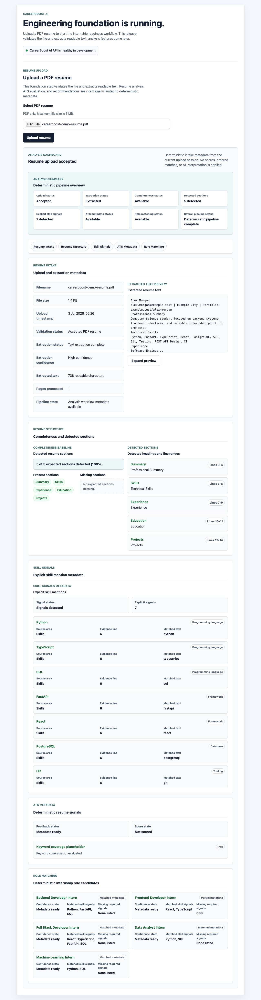
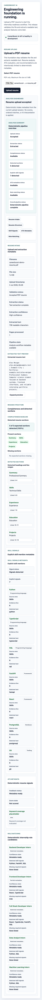
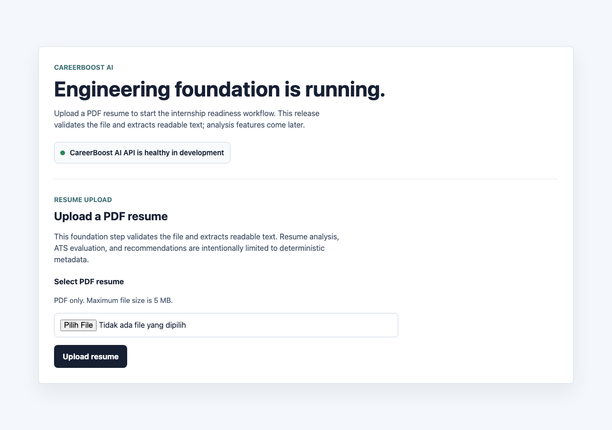
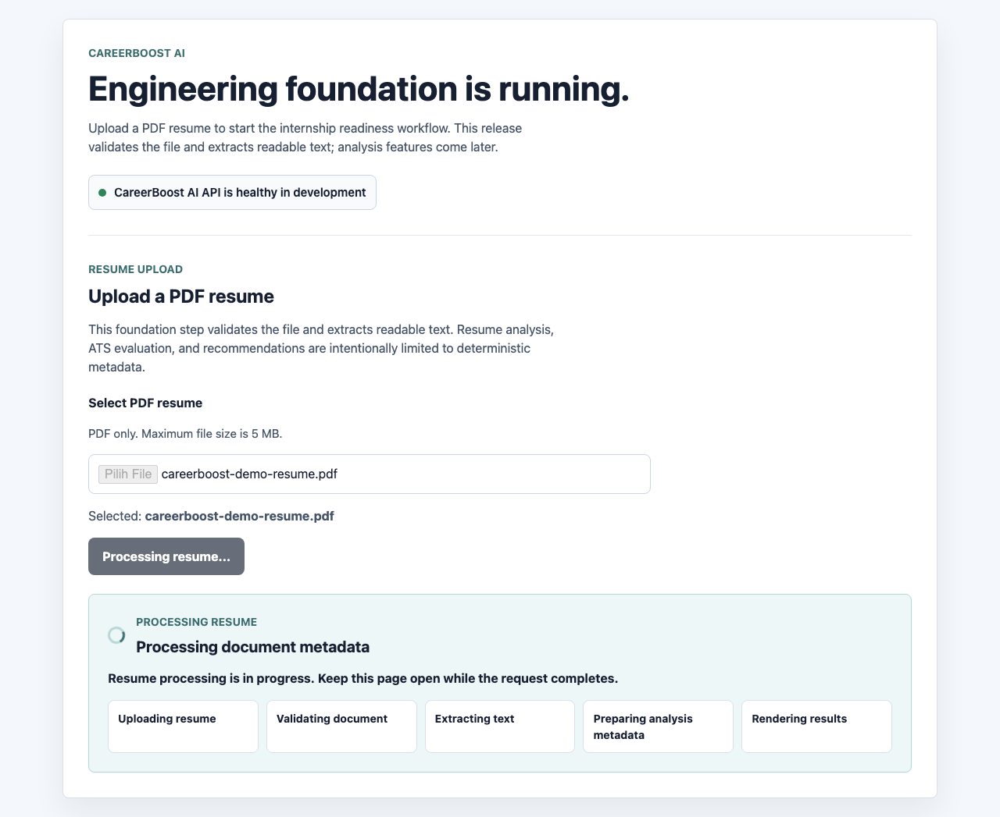
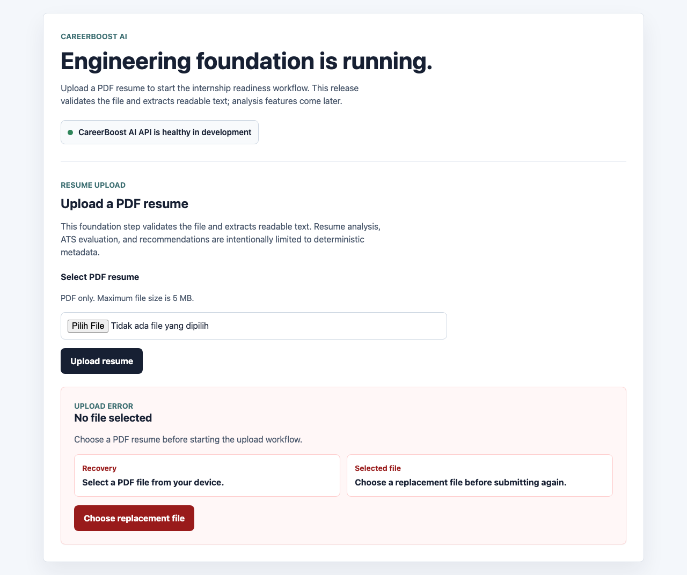
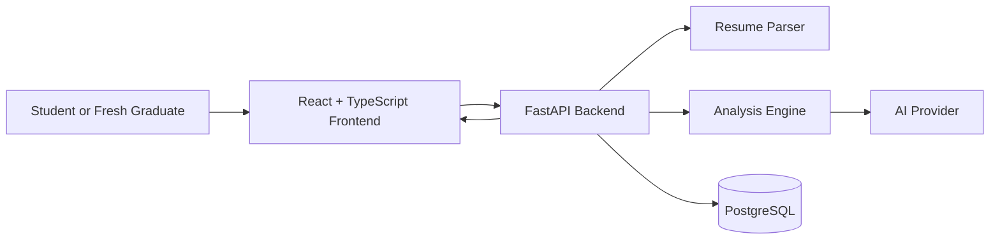

# CareerBoost AI

CareerBoost AI is an internship readiness platform for university students and fresh graduates. The current implementation provides a routed frontend shell, deterministic resume intake, and analysis metadata; future releases are planned to add AI-assisted guidance, scoring, recommendations, persistence, history, target criteria, and reports after explicit contracts are designed and validated.

This repository is being built as a production-quality engineering portfolio project. The goal is not to ship a quick demo, but to demonstrate architecture, product thinking, maintainability, documentation, and disciplined software delivery.

## Why CareerBoost AI Exists

Students often apply to internships without knowing whether their resume is ATS-friendly, whether their technical skills match the roles they want, or what they should improve next. Generic resume scanners usually provide shallow scores, while job boards rarely explain readiness gaps.

CareerBoost AI focuses on one core outcome: helping early-career candidates understand where they stand and what action to take next.

## Product Preview

The screenshots below are verified captures from the running local application using the fictional demo resume in [assets/demo/careerboost-demo-resume.pdf](assets/demo/careerboost-demo-resume.pdf). They reflect the current deterministic resume intake pipeline: upload validation, PDF text extraction, metadata preparation, and dashboard rendering. AI scoring, recommendations, persistence, and history are not implemented yet.

### Analysis Dashboard



### Responsive Experience



### Resume Analysis Flow

| Upload | Processing | Result | Error Recovery |
| --- | --- | --- | --- |
|  |  |  |  |

Flow represented: Upload → Validation → Extraction → Deterministic Analysis Metadata → Dashboard.

## Key Features Planned for Version 1.0

- Resume PDF upload with validation and safe failure handling.
- Resume text extraction with confidence-aware processing.
- ATS-focused resume feedback.
- Internship readiness scoring with explanations.
- Technical skill extraction and gap analysis.
- Internship role matching based on the candidate profile.
- Prioritized resume and learning recommendations.
- Analysis dashboard for reviewing results.
- Analysis history for tracking previous resume checks.

## Tech Stack

| Area | Technology |
| --- | --- |
| Frontend | React, Vite, TypeScript |
| Backend | FastAPI, Python |
| Database | PostgreSQL |
| Containerization | Docker |
| Local orchestration | Docker Compose |
| Version control | Git |

## High-Level Architecture Overview

CareerBoost AI will use a modular monolith architecture with Clean Architecture boundaries. The system is intentionally designed to be realistic for a single developer to build while still demonstrating professional separation of concerns.



Core architectural direction:

- The frontend presents workflows and results, but does not own business logic.
- The backend owns validation, orchestration, analysis coordination, and persistence.
- AI provider integration stays behind a backend infrastructure boundary.
- PostgreSQL stores analysis records and history.
- Docker Compose will provide a reproducible local development environment.

## Repository Structure

The repository contains the backend, frontend, documentation, and verified demo assets for the current deterministic resume intake workflow.

Current structure:

```text
.
├── assets/       Verified screenshots and fictional demo resume
├── backend/      FastAPI application
├── frontend/     React + Vite + TypeScript application
├── docs/         Product, architecture, roadmap, and engineering documentation
├── .github/      Repository templates and ownership configuration
└── README.md
```

## Development Roadmap

| Milestone | Focus | Status |
| --- | --- | --- |
| Sprint 0 | Repository foundation and governance | Completed |
| Sprint 1 | Backend and frontend engineering foundation | Completed |
| Sprint 1.5 | Repository quality automation and release engineering | Completed |
| Sprint 2 | Resume upload, validation, extraction, and deterministic metadata | Completed |
| Sprint 3 | Deterministic skill signals and internship role metadata | Completed |
| Sprint 4 | Dashboard experience, accessibility, visual polish, and demo assets | Completed |
| Sprint 5 | Product workflow expansion and product intelligence | In progress |

## Current Project Status

CareerBoost AI currently has a deterministic resume intake and analysis metadata workflow.

Completed work:

- Open-source license.
- Git ignore rules for the planned stack.
- Editor formatting configuration.
- Environment variable example.
- Contribution, conduct, security, changelog, ownership, issue, and pull request standards.
- FastAPI backend foundation with health endpoint.
- React, Vite, and TypeScript frontend foundation.
- GitHub Actions CI.
- Dependabot dependency monitoring.
- Pre-commit quality gate.
- Backend and frontend coverage reporting.
- Resume PDF upload validation.
- PDF text extraction with confidence metadata.
- Canonical structured analysis contract.
- Deterministic section detection and completeness baseline.
- Deterministic ATS feedback metadata without scoring.
- Deterministic skill signal metadata.
- Deterministic internship role matching metadata.
- Multi-page frontend shell with Home, Upload CV, History, Result placeholder, and not-found routes.
- Accessible, responsive analysis dashboard.
- Processing state and structured upload error recovery.
- Accessibility remediation and visual consistency polish.
- Verified demo screenshots using fictional resume data.

Not started yet:

- Database schema.
- Docker Compose runtime.
- ATS scoring.
- AI integration.
- Inferred skill assessment.
- Ranked role recommendations.
- Recommendations.
- Persistence and history.
- Target criteria configuration.
- Downloadable standalone HTML reports.
- Demo deployment.

Blocked:

- Docker Compose runtime, Dockerfiles, and Docker development workflow are blocked until a compatible Docker runtime is available.

Screenshots are available in [assets/screenshots](assets/screenshots). Demo asset policy and regeneration notes are documented in [docs/DEMO_ASSETS.md](docs/DEMO_ASSETS.md).

## Engineering Principles

- Maintain clean boundaries between presentation, application, domain, and infrastructure concerns.
- Keep business logic out of UI components.
- Keep database access out of route handlers.
- Prefer explicit, readable code over clever abstractions.
- Validate user input defensively.
- Treat resumes as sensitive user data.
- Keep changes small, tested, documented, and reviewable.
- Optimize for maintainability, testability, security, and recruiter-readable engineering quality.

## Getting Started

The repository contains a working backend, frontend, deterministic resume intake workflow, verified demo assets, and documentation. Docker commands remain unavailable until Docker validation is unblocked.

Clone the repository:

```bash
git clone <repository-url>
cd CareerBoost-AI
```

Inspect available repository automation:

```bash
make help
make doctor
```

Install local development dependencies:

```bash
make install
```

Run the standard validation suite:

```bash
make check
```

Create local runtime configuration when needed:

```bash
cp .env.example .env
```

Docker setup commands will be added after Docker validation is unblocked.

## Documentation Index

Existing documentation:

- [License](LICENSE)
- [Changelog](CHANGELOG.md)
- [Contributing Guide](CONTRIBUTING.md)
- [Code of Conduct](CODE_OF_CONDUCT.md)
- [Security Policy](SECURITY.md)
- [Environment Example](.env.example)
- [Development Guide](docs/DEVELOPMENT.md)
- [Demo Assets Guide](docs/DEMO_ASSETS.md)
- [Sprint 1 Completion Report](docs/SPRINT_1_COMPLETION_REPORT.md)
- [Sprint 1.5 Completion Report](docs/SPRINT_1_5_COMPLETION_REPORT.md)
- [Sprint 4 Completion Report](docs/SPRINT_4_COMPLETION_REPORT.md)
- [Blocked Backlog](docs/BLOCKED_BACKLOG.md)
- [Product Requirements Document](docs/PRD.md)
- [System Architecture](docs/SYSTEM_ARCHITECTURE.md)
- [Engineering Constitution](docs/ENGINEERING_CONSTITUTION.md)
- [Roadmap](docs/ROADMAP.md)
- [Decision Log](docs/DECISION_LOG.md)

## Versioning Strategy

CareerBoost AI follows Semantic Versioning.

| Version | Meaning |
| --- | --- |
| `v0.0.1` | Repository bootstrap |
| `v0.1.0` | Product and architecture documentation baseline |
| `v0.2.0` | Backend foundation |
| `v0.3.0` | Frontend foundation |
| `v0.4.0` | Resume upload and validation workflow |
| `v0.5.0` | Resume parsing and analysis workflow |
| `v0.6.0` | Deterministic dashboard and verified demo assets |
| `v0.7.0` | Product intelligence foundation |
| `v0.9.0` | Version 1.0 release candidate |
| `v1.0.0` | Complete approved Version 1.0 product scope |

## License

CareerBoost AI is licensed under the [MIT License](LICENSE).

## Author

Justin Dwinata

CareerBoost AI is developed as a flagship software engineering portfolio project focused on production-quality execution, architecture discipline, and practical value for students preparing for internships.
