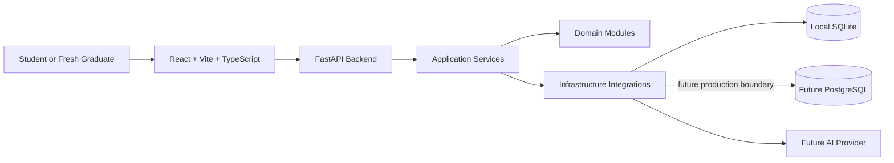
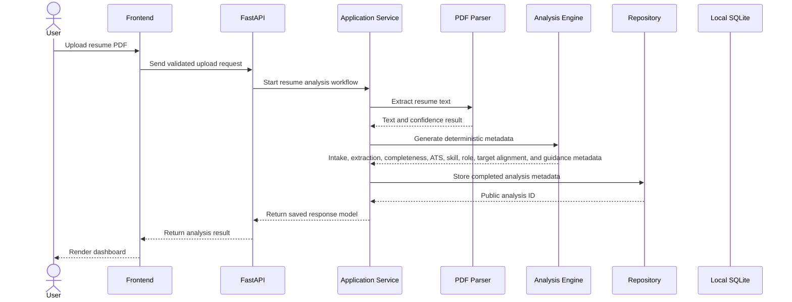

# CareerBoost AI System Architecture

## Status

Canonical technical architecture for Version 1.0.

## High-Level Architecture

CareerBoost AI uses a modular monolith with Clean Architecture boundaries. This is deliberate: the project must remain realistic for one developer while still demonstrating professional separation of concerns.

## Layers

| Layer | Responsibility | Must Not Contain |
| --- | --- | --- |
| Presentation | React UI, FastAPI route handlers, request/response mapping | Business rules, database queries, AI prompts |
| Application | Use-case orchestration, validation pipeline, workflow state | Framework-specific request objects, raw SQL, UI logic |
| Domain | Resume readiness concepts, ATS feedback rules, role matching concepts, recommendation models | FastAPI, React, database drivers, external API clients |
| Infrastructure | Local SQLite history storage, future PostgreSQL access, PDF parsing libraries, AI provider clients, logging, configuration | Product workflow decisions hidden inside adapters |

## Module Boundaries

| Module | Boundary |
| --- | --- |
| Landing | Presents product value and routes users into upload flow |
| Upload | Handles file selection, client hints, and upload state |
| Parser | Extracts text and confidence metadata from PDFs |
| ATS Feedback Metadata | Maps existing deterministic resume metadata into non-scored ATS feedback categories |
| Skill Signal Extraction | Identifies explicit skill mentions and evidence from resume text without inferring ability |
| Role Matching Metadata | Maps deterministic resume signals to internship role metadata without ranking or recommendations |
| Target Alignment Metadata | Compares submitted target criteria with explicit skills, detected sections, metadata availability, and controlled role names without scoring |
| Analysis History Persistence | Stores completed canonical analysis responses in local SQLite for demo retrieval without saving PDF binaries |
| Report Generation | Generates escaped standalone HTML reports from stored canonical analysis responses |
| Recommendation Engine | Generates deterministic improvement guidance from existing analysis metadata without AI, scoring, ranking, or hiring prediction |
| Dashboard | Presents analysis results without recalculating business logic |
| History | Displays previous analysis records and statuses |
| Configuration | Loads runtime settings from environment variables |
| Logging | Emits structured, privacy-safe logs |

## Frontend Route Inventory

The frontend is now organized as a routed React application shell. Routes own page composition and navigation state, while deterministic resume intake remains inside the existing upload component and backend orchestration.

| Route | Page Boundary | Current Behavior |
| --- | --- | --- |
| `/` | Home | Presents current deterministic capabilities, workflow overview, and an honest recent-activity empty state |
| `/upload` | Upload CV | Hosts the existing PDF upload, processing, error recovery, and analysis dashboard workflow |
| `/history` | Analysis History | Lists locally stored analysis summaries, supports refresh and delete, and links to result routes |
| `/results/:analysisId` | Individual Analysis Result | Retrieves a locally stored canonical analysis response and renders the shared analysis dashboard without requiring a resume re-upload |
| `*` | Not Found | Provides accessible recovery navigation to Home and Upload CV |

The frontend must not fabricate analysis records, persist records in browser storage, generate report content client-side, or turn target alignment metadata into scoring, AI-generated recommendations, or hiring conclusions.

Target Application Criteria are accepted as optional upload metadata through a multipart `target_criteria` JSON field. The backend validates and normalizes the criteria, compares them against existing deterministic resume evidence, and returns factual Target Alignment metadata in the canonical analysis response. Deterministic improvement guidance may reference missing target evidence, but no alignment scoring, fit calculation, acceptance prediction, or AI-generated recommendation is performed from these criteria.

## Backend API Route Inventory

The implemented backend API is documented in [API Contracts](API_CONTRACTS.md). Route handlers remain thin presentation adapters; validation, orchestration, report generation, and persistence live behind service/domain boundaries.

| Route | Method | Boundary |
| --- | --- | --- |
| `/health` | `GET` | Process health and environment metadata |
| `/resumes/upload` | `POST` | Multipart PDF upload, optional target criteria JSON, deterministic analysis orchestration, and successful-analysis persistence |
| `/analyses` | `GET` | Local saved-analysis summary listing with limit and offset |
| `/analyses/{analysis_id}` | `GET` | Full canonical stored analysis retrieval |
| `/analyses/{analysis_id}` | `DELETE` | Local saved-analysis deletion |
| `/analyses/{analysis_id}/report.html` | `GET` | Standalone escaped HTML report download generated from stored deterministic metadata |

These routes are local portfolio/demo contracts, not an authenticated production public API.

## Communication Flow

Completed analyses are stored through a local SQLite repository at `data/careerboost_history.sqlite3` by default. This is local demo persistence only: it is not authenticated multi-user storage and does not replace the planned PostgreSQL production boundary.

## Validation Strategy

- Frontend validation gives fast feedback but is never trusted as final.
- Backend validation is the source of truth for file type, size, readability, and workflow state.
- PDF parsing must report low-confidence extraction rather than pretending analysis is reliable.
- Future AI output must be validated into structured backend-owned response models before persistence or display.
- Tests must cover success states, invalid inputs, and recoverable failure states.

## Security Boundaries

- AI provider keys must never enter frontend code.
- Resume files and extracted text are sensitive user data.
- Logs must not include full resume text, secrets, private keys, phone numbers, or email addresses extracted from resumes.
- Upload size and content type limits are mandatory.
- Internal exceptions must be logged safely and mapped to user-safe responses.
- CORS must allow only configured frontend origins.

## Current Implementation State

Implemented:

- Backend FastAPI foundation.
- Backend configuration and structured logging foundation.
- Backend `/health` endpoint.
- Frontend Vite React TypeScript foundation.
- Frontend backend-health status panel.
- CI, Dependabot, pre-commit, coverage, and Makefile quality gates.
- PDF-only resume upload endpoint with defensive backend validation.
- User-safe upload validation and extraction failure responses.
- PDF text extraction with extraction confidence metadata.
- Canonical structured analysis response contract.
- Backend resume intake orchestration service.
- Deterministic extracted-text normalization.
- Deterministic section detection for English, Indonesian, and mixed headings covering core CV sections.
- Advisory extraction-quality warnings for unusual section order and weak extracted section content.
- Deterministic completeness baseline based only on detected section presence.
- Deterministic ATS feedback contract with stable issue categories and a `not_scored` score placeholder.
- Deterministic ATS feedback service based only on extraction, detected-section, and completeness metadata.
- Deterministic skill signal extraction from explicit resume text mentions.
- Deterministic internship role matching metadata without ranking or recommendation claims.
- Deterministic improvement guidance from existing metadata without AI, scoring, ranking, or hiring prediction.
- Multi-page frontend shell with Home, Upload CV, functional History, Result placeholder, and not-found routes.
- Target Application Criteria input, backend validation, and canonical response metadata echo.
- Deterministic Target Alignment metadata comparing submitted criteria against explicit resume evidence without scoring.
- Backend local history API with `GET /analyses`, `GET /analyses/{analysis_id}`, and `DELETE /analyses/{analysis_id}`.
- Backend standalone HTML report endpoint with `GET /analyses/{analysis_id}/report.html`.
- Frontend History page connected to `GET /analyses` and `DELETE /analyses/{analysis_id}` for local saved-analysis summaries.
- Frontend Result page connected to `GET /analyses/{analysis_id}` for stored canonical analysis detail retrieval.
- Frontend Result page HTML report download action backed by stored deterministic metadata.
- Shared analysis dashboard component reused by upload success and stored result detail views.
- Upload result UI showing intake metadata, extraction metadata, completeness baseline, detected section details, improvement guidance, extracted-text preview, ATS feedback metadata, skill signal metadata, and role matching metadata.
- Accessible processing experience, structured upload error recovery, focus management, live regions, and responsive dashboard navigation.
- Visual consistency pass for dashboard sections, metadata cards, badges, empty states, and mobile layouts.
- Verified desktop and mobile screenshots generated from the running application using a fictional demo resume.

Not yet implemented:

- ATS scoring.
- AI-generated recommendations.
- PDF report generation.
- OCR for scanned or image-only resumes.
- Database schema.
- AI integration.
- Docker runtime artifacts.

The current pipeline prepares resume data and displays deterministic metadata and evidence-backed improvement guidance. It does not claim internship readiness, ATS compatibility, ATS pass/fail status, ranked role fit, AI-generated recommendations, or hiring outcomes.

Docker remains blocked until a compatible runtime is available and validation can run.
