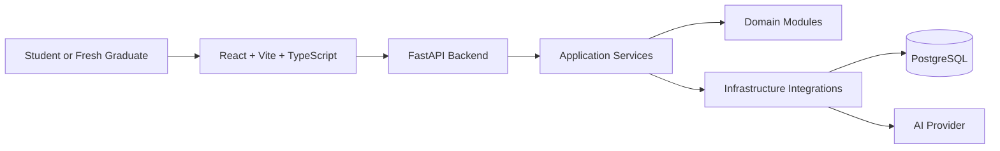
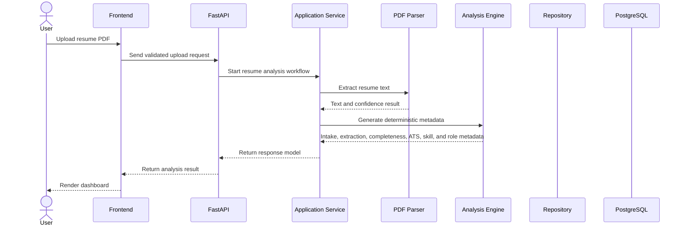

# CareerBoost AI System Architecture

## Status

Canonical technical architecture for Version 1.0.

## High-Level Architecture

CareerBoost AI uses a modular monolith with Clean Architecture boundaries. This is deliberate: the project must remain realistic for one developer while still demonstrating professional separation of concerns.

## Layers

| Layer | Responsibility | Must Not Contain |
| --- | --- | --- |
| Presentation | React UI, FastAPI route handlers, request/response mapping | Business rules, database queries, AI prompts |
| Application | Use-case orchestration, validation pipeline, workflow state | Framework-specific request objects, raw SQL, UI logic |
| Domain | Resume readiness concepts, ATS feedback rules, role matching concepts, recommendation models | FastAPI, React, database drivers, external API clients |
| Infrastructure | PostgreSQL access, PDF parsing libraries, AI provider clients, logging, configuration | Product workflow decisions hidden inside adapters |

## Module Boundaries

| Module | Boundary |
| --- | --- |
| Landing | Presents product value and routes users into upload flow |
| Upload | Handles file selection, client hints, and upload state |
| Parser | Extracts text and confidence metadata from PDFs |
| ATS Feedback Metadata | Maps existing deterministic resume metadata into non-scored ATS feedback categories |
| Skill Signal Extraction | Identifies explicit skill mentions and evidence from resume text without inferring ability |
| Role Matching Metadata | Maps deterministic resume signals to internship role metadata without ranking or recommendations |
| Recommendation Engine | Future module for prioritized resume and learning actions |
| Dashboard | Presents analysis results without recalculating business logic |
| History | Displays previous analysis records and statuses |
| Configuration | Loads runtime settings from environment variables |
| Logging | Emits structured, privacy-safe logs |

## Frontend Route Inventory

The frontend is now organized as a routed React application shell. Routes own page composition and navigation state, while deterministic resume intake remains inside the existing upload component and backend orchestration.

| Route | Page Boundary | Current Behavior |
| --- | --- | --- |
| `/` | Home | Presents current deterministic capabilities, workflow overview, and an honest recent-activity empty state |
| `/upload` | Upload CV | Hosts the existing PDF upload, processing, error recovery, and analysis dashboard workflow |
| `/history` | Analysis History | Shows that saved analysis history is unavailable until persistence is implemented |
| `/results/:analysisId` | Individual Analysis Result | Shows a safe unavailable state because persisted result retrieval is not implemented |
| `*` | Not Found | Provides accessible recovery navigation to Home and Upload CV |

The frontend must not fabricate analysis records, persist records in browser storage, generate reports, or turn target criteria into alignment conclusions until those capabilities have approved backend and product contracts.

Target Application Criteria are currently accepted as optional upload metadata through a multipart `target_criteria` JSON field. The backend validates and normalizes the criteria, then returns them in the canonical analysis response. No alignment scoring, fit calculation, acceptance prediction, or recommendation generation is performed from these criteria yet.

## Communication Flow

Persistence and history remain planned Version 1.0 capabilities. The current request lifecycle returns the structured analysis result without writing analysis records to PostgreSQL.

## Validation Strategy

- Frontend validation gives fast feedback but is never trusted as final.
- Backend validation is the source of truth for file type, size, readability, and workflow state.
- PDF parsing must report low-confidence extraction rather than pretending analysis is reliable.
- AI output must be validated into structured backend-owned response models before persistence or display.
- Tests must cover success states, invalid inputs, and recoverable failure states.

## Security Boundaries

- AI provider keys must never enter frontend code.
- Resume files and extracted text are sensitive user data.
- Logs must not include full resume text, secrets, private keys, phone numbers, or email addresses extracted from resumes.
- Upload size and content type limits are mandatory.
- Internal exceptions must be logged safely and mapped to user-safe responses.
- CORS must allow only configured frontend origins.

## Current Implementation State

Implemented:

- Backend FastAPI foundation.
- Backend configuration and structured logging foundation.
- Backend `/health` endpoint.
- Frontend Vite React TypeScript foundation.
- Frontend backend-health status panel.
- CI, Dependabot, pre-commit, coverage, and Makefile quality gates.
- PDF-only resume upload endpoint with defensive backend validation.
- User-safe upload validation and extraction failure responses.
- PDF text extraction with extraction confidence metadata.
- Canonical structured analysis response contract.
- Backend resume intake orchestration service.
- Deterministic extracted-text normalization.
- Deterministic section detection for `summary`, `skills`, `experience`, `education`, and `projects`.
- Deterministic completeness baseline based only on detected section presence.
- Deterministic ATS feedback contract with stable issue categories and a `not_scored` score placeholder.
- Deterministic ATS feedback service based only on extraction, detected-section, and completeness metadata.
- Deterministic skill signal extraction from explicit resume text mentions.
- Deterministic internship role matching metadata without ranking or recommendation claims.
- Multi-page frontend shell with Home, Upload CV, History, Result placeholder, and not-found routes.
- Target Application Criteria input, backend validation, and canonical response metadata echo.
- Upload result UI showing intake metadata, extraction metadata, completeness baseline, detected section details, extracted-text preview, ATS feedback metadata, skill signal metadata, and role matching metadata.
- Accessible processing experience, structured upload error recovery, focus management, live regions, and responsive dashboard navigation.
- Visual consistency pass for dashboard sections, metadata cards, badges, empty states, and mobile layouts.
- Verified desktop and mobile screenshots generated from the running application using a fictional demo resume.

Not yet implemented:

- ATS scoring.
- Recommendations.
- Persistence and analysis history.
- Target criteria alignment logic.
- Standalone HTML report generation.
- Database schema.
- AI integration.
- Docker runtime artifacts.

The current pipeline prepares resume data and displays deterministic metadata for future analysis. It does not claim internship readiness, ATS compatibility, ATS pass/fail status, ranked role fit, or improvement recommendations.

Docker remains blocked until a compatible runtime is available and validation can run.
